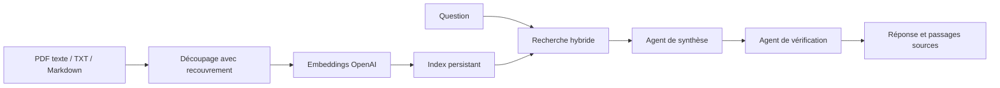

# Source — Mon assistant documentaire RAG

Démo de classe en français : importer des documents, poser une question et retrouver les passages qui justifient la réponse. Le projet est prêt pour **Google Cloud Run**, avec corpus persistant dans **Cloud Storage** et clé fournie par **Secret Manager**.

## Démarrer localement

Python 3.12 ou ultérieur.

```bash
python3 -m venv .venv
source .venv/bin/activate
pip install -r requirements.txt
python app.py
```

Ouvrir <http://127.0.0.1:8765>. Sans clé, sélectionner le **mode extraits** : recherche lexicale et extraits originaux, sans génération IA. Cliquer sur **Charger le corpus de démo**, puis sur une question proposée.

Pour le RAG, fournir `OPENAI_API_KEY` par l’environnement ou dans un fichier `.env` ignoré par Git. Le fichier `.env.example` décrit la configuration. Un fichier existant peut être lu sans être copié : `python app.py --env-file /chemin/vers/.env`. Ne jamais publier une clé. Modèles configurables via `OPENAI_MODEL` et `OPENAI_EMBEDDING_MODEL`.

## Ce que fait le RAG



1. **Indexation** : extraction par page, fragments d’environ 1 200 caractères avec recouvrement de 180 caractères, embeddings `text-embedding-3-small`.
2. **Recherche** : similarité cosinus et recouvrement lexical (80 % / 20 %). Le filtre sémantique est fixé à 0,25 ; cinq passages maximum sont retenus. Ce seuil est une heuristique à calibrer, pas une mesure de vérité.
3. **Synthèse** : premier appel à la Responses API avec sortie JSON structurée et consigne de citer les sources.
4. **Vérification** : second appel distinct au modèle, relecture de la réponse et correction des affirmations non étayées. Le serveur contrôle que les identifiants cités existent ; sinon il refuse la réponse. La vérification sémantique reste probabiliste.

La recherche est déterministe ; les deux agents IA sont des rôles spécialisés dans une orchestration séquentielle. Ils ne naviguent pas et ne s’auto-attribuent pas de tâches. Les questions sont indépendantes : aucun historique conversationnel n’est envoyé au modèle.

Références d’implémentation : [embeddings OpenAI](https://developers.openai.com/api/reference/resources/embeddings/methods/create), [Responses API et sorties structurées](https://developers.openai.com/api/reference/resources/responses/methods/create).

## Présentation de classe

Le [scénario de démonstration](docs/DEMO.md) propose un déroulé de cinq minutes, une question croisant deux sources et un test d’information absente. Les trois fiches du dossier `examples/` sont **entièrement fictives**.

## Google Cloud Run

Voir [le guide de déploiement](docs/CLOUD_RUN.md). Le conteneur écoute le port `PORT` sur `0.0.0.0` dans Cloud Run. L’accès est privé par défaut, protégé par l’IAM Cloud Run. Le corpus est partagé entre les utilisateurs autorisés du service : il n’y a pas d’isolation par utilisateur.

Le service ZENAI est accessible via `python scripts/open_cloud.py`, puis <http://127.0.0.1:8080>, pour le compte Google autorisé. Le proxy conserve le jeton temporaire en mémoire. Ce mode d’accès est documenté dans le guide.

En local, SQLite conserve les fragments dans `data/corpus.sqlite3`. Avec `GCS_BUCKET`, chaque transaction utilise un snapshot JSON Cloud Storage et une base SQLite en mémoire. L’écriture utilise une précondition de génération pour empêcher un écrasement concurrent. En cas de conflit, l’opération est refusée et doit être relancée. Les données ne dépendent donc pas du disque éphémère de Cloud Run.

Ce stockage relit le snapshot pour chaque transaction : adapté à un petit corpus de démonstration (32 Mo d’index maximum), pas à une grande bibliothèque. Pour un vrai service multiutilisateur, prévoir authentification applicative, isolation des corpus, quotas et un index vectoriel dédié.

## Confidentialité et limites

- En mode RAG, les textes sont transmis à OpenAI pour l’indexation ; la question et les passages sélectionnés sont envoyés pour les deux appels de génération. `store: false` est envoyé à la Responses API ; cela ne signifie pas une absence totale de traitement ou de rétention par le fournisseur.
- Les fichiers originaux ne sont pas conservés : les textes extraits et embeddings le sont. Les clés, index locaux et fichiers personnels sont exclus de Git et du contexte de build.
- PDF texte uniquement, sans OCR. Maximum : 8 Mo, 150 pages, 250 fragments et 250 000 caractères par document. Une suppression retire les données de l’index actif ; les politiques de rétention du bucket peuvent conserver des versions supprimées.
- Les documents peuvent contenir des instructions malveillantes : le modèle reçoit la consigne de les traiter comme des données. Cette protection n’élimine pas tout risque d’injection de prompt.
- Les scores sont des scores de classement, **pas des pourcentages de confiance**. Une citation existante n’établit pas que chaque affirmation est correcte. Contrôle humain nécessaire.
- Une clé présente n’est pas forcément valide ou créditée. Les erreurs API sont affichées ; aucun basculement silencieux ne prétend avoir généré une réponse IA.

## Vérifications

```bash
python -m unittest discover -s tests -v
node --check static/app.js
```

Les tests utilisent des réponses IA simulées, sans consommation API : import/dédoublonnage, recherche, refus hors corpus, citations invalides, agents distincts, PDF sans texte, suppression et endpoints HTTP. Les tests nécessitent l’ouverture d’un port local. GitHub Actions les exécute à chaque push et pull request.

Interface : direction Achromatic ledger, fond gris bleuté documentaire, références bleues et passages exacts à côté de la réponse. Typographie système pour fonctionner sans police distante. Aucun document personnel n’est livré avec la démo.
